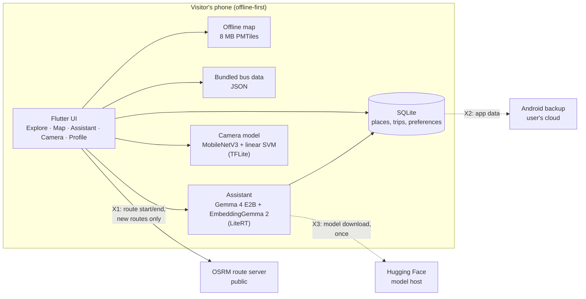
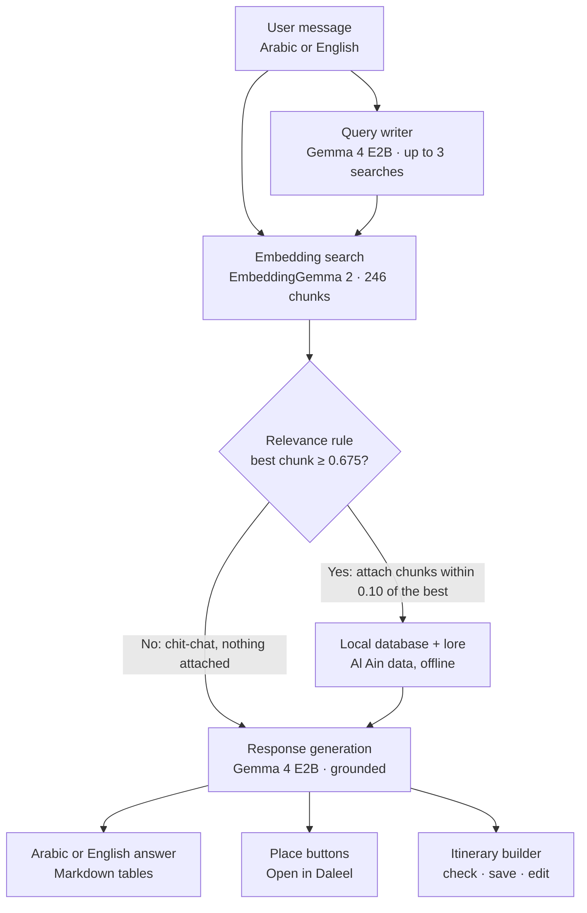
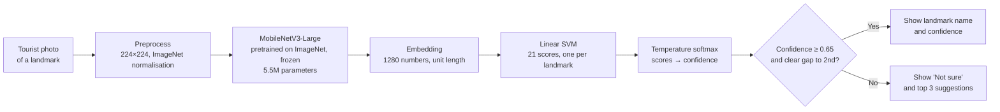
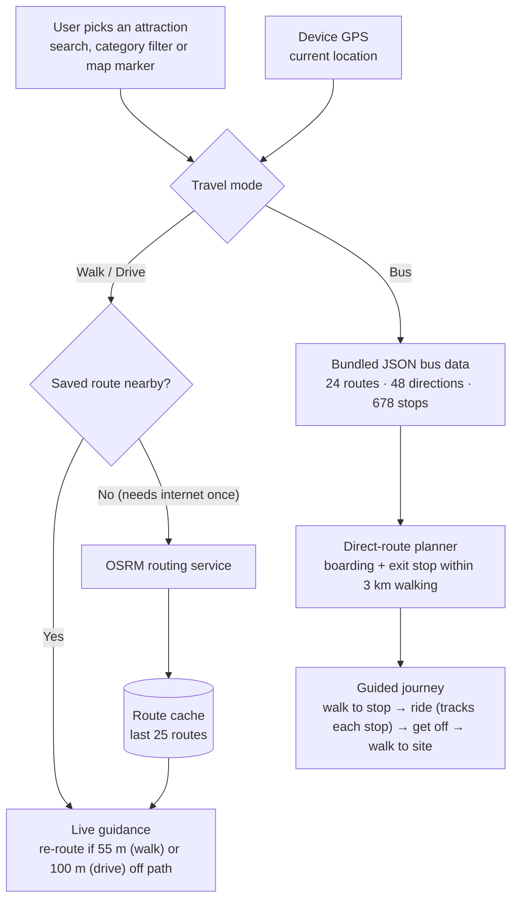
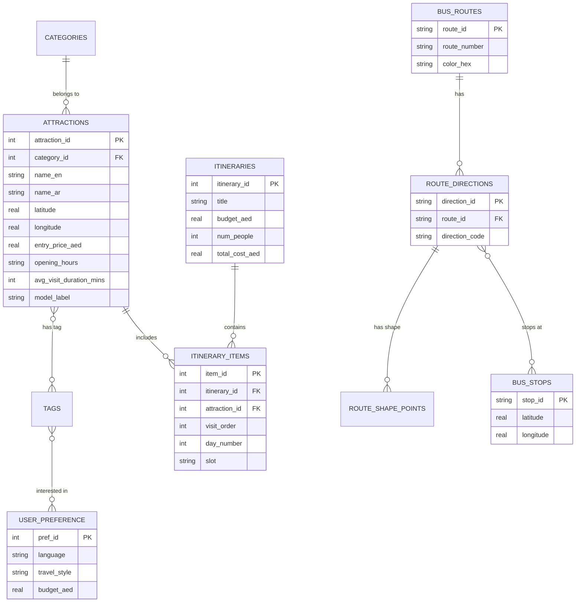
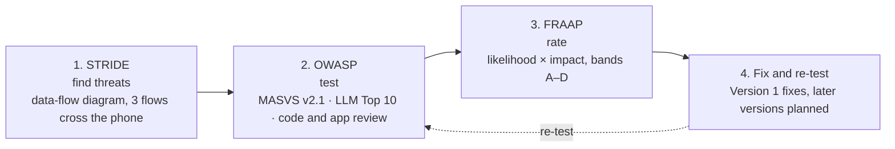

# Daleel — Al Ain Tourism App

**An offline-first travel planning system with on-device AI.**
Daleel is a Flutter (Android-first) app that puts a whole trip to Al Ain in one place: places that match you, an assistant that runs on the phone, landmark recognition from a photo, and an offline map with routes and buses. It works in English and Arabic (full right-to-left).

> Graduation project (SGP2), Group 16. Senior supervisor: Jamil Ahmed Shakeel Ahmed.
> Team: Sara Ali Al Messabi, Shamsa Abdulla Alamro, Hessa Khaled Almarzooqi, Lydia Iratni.

## Contents

1. [Why Daleel](#why-daleel)
2. [Features](#features)
3. [Architecture](#architecture)
4. [The assistant (on-device RAG)](#the-assistant-on-device-rag)
5. [Landmark recognition (camera)](#landmark-recognition-camera)
6. [Map, routing and buses](#map-routing-and-buses)
7. [Database](#database)
8. [Security assessment](#security-assessment)
9. [Project structure](#project-structure)
10. [Getting started](#getting-started)
11. [Updating the data](#updating-the-data)
12. [Known limits and roadmap](#known-limits-and-roadmap)

## Why Daleel

| Problem tourists face in Al Ain | What Daleel does |
|---|---|
| Information is scattered across many sites and apps, often outdated | One app for the whole trip |
| Data abroad is costly, and signal is weak at remote sites | Map, places, buses, assistant and camera all work with no internet |
| Location and questions leave the phone | The assistant and camera run on the device; chats stay on the phone |

## Features

| Feature | Status in this prototype |
|---|---|
| AI assistant on the phone | Delivered (Gemma 4 E2B + EmbeddingGemma 2) |
| Landmark recognition from a photo | Delivered, 21 landmarks |
| Places and day plans that match you | Delivered (welcome quiz, ranked Explore, itinerary builder) |
| Offline map, GPS, routes, buses | Delivered; new walk/drive routes need internet once |
| Arabic support | Delivered, full right-to-left |
| Encrypted user data | Next: Version 3 |
| iOS version | Next: Android was built first |

## Architecture

Everything in the app runs on the phone. Only three flows ever cross to the outside world.



**Tools used:** Flutter, SQLite, LiteRT, Gemma 4, Hugging Face, OpenStreetMap, Firebase, Google Colab (model training).

## The assistant (on-device RAG)

The assistant answers from Daleel's own offline guide: two `.txt` knowledge files plus the app database, split into **246 chunks**. EmbeddingGemma 2 searches the chunks on the device and Gemma 4 E2B writes the answer. The chat page renders Markdown tables, shows "open in Daleel" buttons for places the answer mentions, and can turn a day-by-day answer into a saved itinerary.



* Chit-chat scores about 0.55 to 0.66; real questions score about 0.69 to 0.86, so the cutoff sits at 0.675.
* The prompt window is capped at 4,096 tokens (reply included); the lowest-scoring chunks are dropped if the prompt would not fit.
* The itinerary builder reads the answer's "Day 1, Day 2 … Morning/Afternoon/Evening" structure, matches place names to the database, then adds prices, visit times, opening-hours warnings, repeated stops, over-long days and budget checks. The model decides *what* to visit; the app only adds facts and arithmetic.
* The first version of the design considered a larger multimodal pipeline (Gemma 3, Jais 2); the final implementation is the leaner pipeline above.

## Landmark recognition (camera)

A tourist photo goes through a frozen MobileNetV3-Large feature extractor, then a small linear SVM that is the only part we trained.



**Dataset:** 21 Al Ain landmarks, 352 public visitor photos (Google Maps and official sites), 5 to 35 photos per landmark. Only landmarks with at least 5 photos were kept, because 5-fold cross-validation needs that. A first attempt on the whole attraction area reached only about 40% accuracy; photographing the **front entrance** of each site fixed it.

**Fair test:** stratified 5-fold cross-validation, the same folds for every model, test photos never changed. Because the classes are uneven we report balanced accuracy and macro F1 as well as accuracy.

**Augmentation:** 6 modified copies of every training photo (flip, rotate, zoom, perspective, colour, grayscale, blur, hidden patch), kept in the same fold as the original. Average gain: +0.014 (up to +0.026).

**Model comparison (linear SVM head unless noted):**

| Model | Accuracy | Balanced acc. | Macro F1 | Top-3 acc. | Params (M) | ms / photo |
|---|---|---|---|---|---|---|
| DINOv2-Base | 0.977 | 0.961 | 0.969 | 0.991 | 86.6 | 18.8 |
| CLIP ViT-B/32 | 0.943 | 0.925 | 0.936 | 0.991 | 87.8 | 5.0 |
| **MobileNetV3-Large** (used in the app) | 0.923 | 0.889 | 0.889 | 0.966 | 5.5 | 3.3 |
| ViT-Base (IN-21k) | 0.923 | 0.901 | 0.901 | 0.977 | 86.4 | 13.6 |
| MobileNetV3-Small (k-NN, k=3) | 0.901 | 0.872 | 0.898 | 0.932 | 2.5 | 2.9 |

The larger models score higher, but MobileNetV3-Large is small and fast enough to run on a phone, which is what matters for an offline app.

## Map, routing and buses

* **Offline Al Ain map:** one 8 MB PMTiles file of OpenStreetMap data, read with `flutter_map`; no internet needed.
* **Find any attraction:** English and Arabic search, 8 category filters, grouped markers.
* **GPS and Near Me:** live location, nearby places sorted by distance.
* **Walk, drive or bus:** turn-by-turn routes and step-by-step bus journeys.



**Choosing the best bus:** every route is checked for a boarding stop and an exit stop, each within 3 km walking. The best route minimises `walk to stop + walk from stop + 0.02 km per stop`.

| Bus data | Count |
|---|---|
| Bus routes | 24 |
| Directions | 48 |
| Bus stops | 678 |
| Route shape points | 12,210 |

**Limits:** direct routes only (no transfers) and no live arrival times. **Next:** official GTFS-Realtime data for transfers and live buses.

## Database

The app ships `assets/db/al_ain.db` (SQLite) and copies it to private storage on first launch. User data (quiz answers, saved itineraries) is written to the same file.



(The diagram shows the main columns only. `tags`, `attraction_tags`, `events` and `interaction_log` tables also exist.)

## Security assessment

Daleel was assessed with a four-step process: find threats, test, rate, then fix and re-test.



**Result: 28 findings** — A: 2 (fix now), B: 7 (if time), C: 18 (later), D: 1 (accept).

| Flow crossing the phone | Where it goes | Main risk |
|---|---|---|
| X1 route points | OSRM public route server | Strongest finding (F01, band A): every new route sends its start and end to a server that logs requests |
| X2 app data | Android backup (user's cloud) | App data copied out by backup |
| X3 model, once | Hugging Face | Model supply chain (hash-check planned) |

* **MASVS:** 6 of 8 lab checks failed on the original build. Fixes in Version 1: backup off, unused permissions removed (3 flagged, 4 removed), install refused on old phones instead of crashing on launch, release-signing ready.
* **LLM Top 10 (assistant):** prompt injection tested (it stays on Al Ain topics), chats stay on the phone, answers are grounded in app data, consumption capped at 4,096 tokens. Next: hash-check the model file, move the system prompt out of the chat.
* **Camera:** wrong names on 10 test photos dropped from 4 to 1 after the fix (40% → 10%).
* **Testing:** code and app file review, Android emulator (Pixel 7, Android 14), a Galaxy A05 phone, and one real drive to Al Ain Mall with Wi-Fi off midway. The saved route kept guiding without Wi-Fi; the app cannot re-route without internet.
* **Ethics:** UAE PDPL considered (privacy claim corrected for route points); only our own app was tested.

| Planned fix | Version |
|---|---|
| 5 configuration fixes (written and built, phone checks next) | 1 |
| Assistant input filter, after running 40 attack prompts | 2 |
| Encrypt saved data | 3 |
| Routing on the phone (closes F01) | Design change |

## Project structure

```
lib/
  main.dart               app start-up, language and RTL
  app_state.dart          preferences, favourites, tab switching
  data.dart               SQLite access and database upgrade
  strings.dart            all English and Arabic text
  screens/                Explore, place detail, camera, profile, welcome quiz
  assistant/              chat screen and controller
  rag/                    search, prompts and index reading (pure Dart)
  itinerary/              plan extraction, checks, saving
  camera/                 MobileNetV3 + SVM classifier
  map_module/             offline map, routing, bus journeys
assets/
  db/al_ain.db            places, tags, itineraries, bus tables
  data/                   attractions, categories, bus JSON, rag_index.json
  maps/                   al_ain.pmtiles + style
  model/                  mobilenetv3_embedder.tflite, svm_head.json
  images/                 place photos
plugins/daleel/           Claude Code plugin for editing app data
```

## Getting started

Requirements: Flutter SDK (Dart ^3.13.5) and an Android device or emulator (Android 11 / API 30 or newer).

```bash
git clone https://github.com/SaraAlMessabie/Daleel-Al-Ain-Tourism-App-.git
cd Daleel-Al-Ain-Tourism-App-
flutter pub get
flutter run
```

* **Assistant:** the first time you open the Assistant tab it downloads the search model and the language model (about 2.6 GB total, use Wi-Fi). After that it works offline. If a download says the model is gated, run with `--dart-define=HUGGINGFACE_TOKEN=hf_xxx`. Never commit a token.
* **APK:** `flutter build apk --release` (add `--split-per-abi` for smaller files). The APK is in `build/app/outputs/flutter-apk/`. Put your keystore details in `android/key.properties` to sign with your own key; without it the debug key is used.
* **Checks:** `flutter analyze` and `flutter test`.

## Updating the data

Places live in `assets/db/al_ain.db`, the one source of truth. The map reads `assets/data/attractions.json`, which is generated from the database, and the assistant reads `assets/data/rag_index.json`:

1. Edit the database (fill the `_ar` columns too), then run `python3 plugins/daleel/scripts/export_map_json.py` to refresh the map's JSON. Every image path must exist in `assets/images/`.
2. Rebuild `rag_index.json` with your embedding pipeline (EmbeddingGemma 2, 270m). Vectors cannot be edited by hand.
3. Raise `Db.bundledDbVersion` in `lib/data.dart`. On the next start the app installs the new database and carries the user's quiz answers and saved itineraries over.
4. Run `python3 plugins/daleel/scripts/check_data.py`. It checks ids, categories, images, locations, that the JSON matches the database, search-index links and English/Arabic string parity. GitHub runs it, `flutter analyze`, `flutter test` and an Android build on every push (`.github/workflows/check.yml`).

The repo also contains a Claude Code plugin (`plugins/daleel`) with skills for adding attractions, adding bilingual strings and running that check:

```
/plugin marketplace add SaraAlMessabie/Daleel-Al-Ain-Tourism-App-
/plugin install daleel@daleel
```

## Known limits and roadmap

* New walk/drive routes need the internet once; the app cannot re-route offline.
* Bus journeys are direct routes only, with no live arrival times.
* The camera knows 21 landmarks (those with at least 5 photos).
* **Next:** larger assistant with an offline/online switch; accessibility (screen reader labels, larger text, high contrast, voice reading); more languages (Hindi, Russian, Chinese first); a submission form for organisers (admin-checked); more landmark photos from different angles and times, plus photos of other parts of each place with GPS as a second clue; iOS release; GTFS-Realtime buses; encrypted saved data.

## Credits

Presentation template by Slidesgo (icons by Flaticon, infographics and images by Freepik). Map data © OpenStreetMap contributors.
